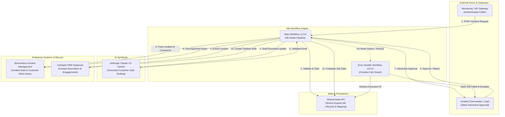
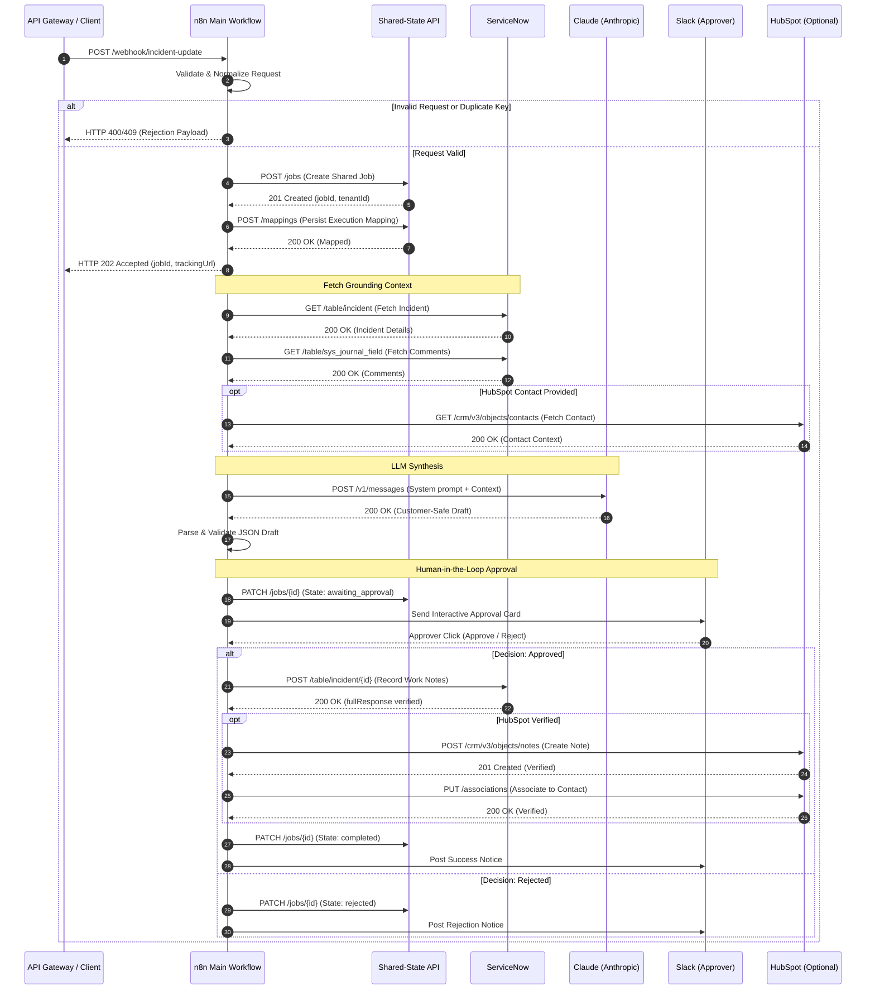
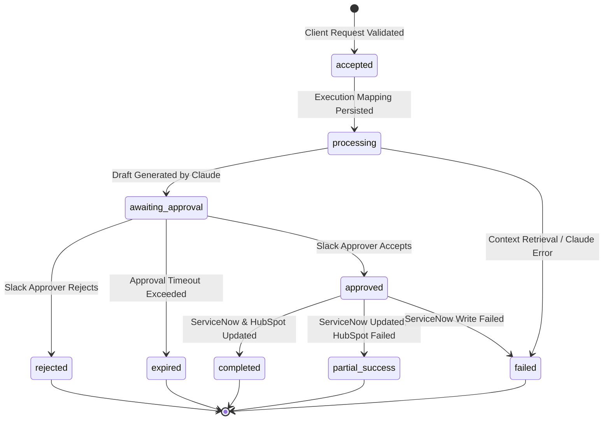

# Architecture — Customer-Safe Incident Update Writer (v2.3.5)

## Overview

The **Customer-Safe Incident Update Writer** is an enterprise-grade automated workflow package designed for n8n. It ingests internal incident records (e.g. from ServiceNow), normalizes context, engages Anthropic Claude to synthesize customer-safe, grounded updates, enforces mandatory human-in-the-loop authorization via Slack interactive approvals, and commits verified updates back to ServiceNow and optional customer engagement systems (HubSpot).

All lifecycle transitions, execution-to-job bindings, and audit trails are managed via a tenant-isolated, OpenAPI-specified **Shared-State API**.

---

## Workflow Components

The repository delivers two production-ready workflow exports and a central OpenAPI contract:

1. **Main Workflow (`customer-safe-incident-update-writer-v2.3.5.json` — 66 Nodes)**:
   - Validates incoming payload format, tenant authenticity, and idempotency keys.
   - Enforces the **Request Validity Gate** (`Request Valid?`), safely rejecting invalid or malformed requests with standard rejection payloads without spawning unmapped jobs.
   - Interacts with the **Shared-State API** to provision a tenant-scoped job record and synchronously persists the n8n execution-to-job mapping.
   - Resolves ServiceNow incidents by SysID or Incident Number, retrieving recent work notes and customer-visible comments.
   - Merges verified HubSpot customer context when a contact identifier is supplied.
   - Prompts Claude with strict guidelines to prevent technical data leaks, internal jargon, or unsubstantiated root-cause claims.
   - Publishes an approval request card to Slack with actionable buttons (`Approve`, `Reject`, `Request Changes`).
   - On approval, updates ServiceNow incident work notes with verification checks on HTTP status codes and response bodies (`fullResponse: true`), optionally adds a HubSpot engagement note, and transitions the shared job status to `completed` or `partial_success`.

2. **Error Handler Workflow (`customer-safe-incident-error-handler-v2.3.5.json` — 8 Nodes)**:
   - Activated automatically via the n8n `Workflow Error Trigger` whenever an unhandled failure occurs in the main execution.
   - Uses the native execution ID (`$execution.id`) to query the persistent execution-to-job mapping table in the Shared-State API.
   - Verifies the authenticated tenant matches the stored mapping to prevent cross-tenant data contamination.
   - Transitions the mapped shared job to `failed` with sanitized error details, suppressing internal stack traces and secrets.
   - Sends a controlled alert to the operations Slack channel with execution diagnostics.

3. **Shared-State API Contract (`shared-state-openapi.yaml`)**:
   - Defines strict schemas for tenant isolation (`x-authenticated-tenant-id`), job creation, status queries, execution mapping, and phase transitions.

---

## Detailed Pipeline Execution Sequence

---

## Shared-State Job Lifecycle State Machine

The Shared-State API manages jobs through a deterministic finite-state machine. Transitions must follow the permitted paths documented in `shared-state-openapi.yaml`:

---

## Trust Boundaries & Hardening in v2.3.5

### 1. Request Validity Gate
In v2.3.5, incoming requests pass through `Validate & Normalize Request` directly to `Request Valid?`.
- Valid requests proceed to `Create Shared Job`.
- Invalid payloads (missing incident IDs, malformed JSON, unauthenticated tenant tokens) are immediately routed to `Reject Invalid or Duplicate Request` without invoking the Shared-State API or creating orphan records.

### 2. Tenant Context & Isolation
All Shared-State API requests require the `x-authenticated-tenant-id` header. The tenant ID is extracted from gateway verification and checked on every downstream response. If an API call returns a mismatched tenant ID, the workflow throws an authorization exception immediately.

### 3. Response Wrapping & Context Preservation (`fullResponse: true`)
n8n HTTP Request nodes configured with `response.fullResponse: true` expose both the HTTP `statusCode` and the payload inside `response.body`. Downstream verifier Code nodes:
- Unwrap `response.body || response` to validate business responses.
- Explicitly restore upstream context (such as `incidentId`, `jobId`, `draftText`, `approverId`) to avoid data drop-off during HTTP transitions.

### 4. Fail-Closed Error Mapping
If any node encounters an unhandled runtime error:
1. `Workflow Error Trigger` receives the failure metadata.
2. `Lookup Execution Mapping and Mark Failed` queries the Shared-State API using only `$execution.id`.
3. If an execution mapping is found and the tenant ID matches, `Mark Mapped Job Failed` updates the job.
4. If no mapping exists (e.g. failure occurred prior to mapping creation), the error handler notifies the operator without guessing an incident or job ID.

---

## Validation and Compliance

The repository includes a static analysis and regression testing engine (`static-validation-v235.py`) ensuring:
- All JSON schema exports are valid and uncorrupted.
- All 66 main workflow connections and 8 error workflow connections link existing nodes.
- All embedded JavaScript in Code nodes compiles without syntax errors via `node --check`.
- Shared-state API calls adhere to OpenAPI specifications.
- Regression test suites (`test-context-preservation-v235.py` and `test-critical-workflow-fixes-v235.py`) pass without errors.
