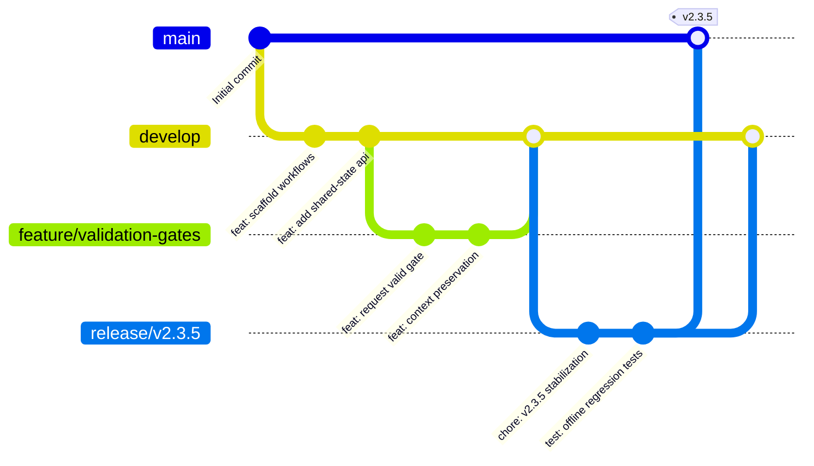

# Branching & Repository Workflow

## Branching Strategy

This project follows a structured Git branching model designed for stable, versioned n8n workflow releases with clear separation between active development and production releases.



---

## Branch Definitions

| Branch | Purpose | Protection Rules |
|---|---|---|
| `main` | Production-ready, validated release snapshots only. Every commit represents a stable versioned release. | Protected. Direct pushes disabled. Requires linear history and passing CI checks. |
| `develop` | Ongoing integration branch where tested features merge prior to release stabilization. | Protected. Pull requests required. |
| `release/vX.Y.Z` | Stabilization branch for a specific release (e.g., `release/v2.3.5`). Only documentation, testing, and critical bugfixes occur here. | Merged into `main` (with release tag) and back into `develop`. |
| `feature/<name>` | Work branches for new capabilities, nodes, or integrations. Branched from `develop`. | Merged into `develop` via pull request after passing local tests. |
| `fix/<name>` | Urgent bug fixes or verifier corrections. Branched from `develop` (or `main` for hotfixes). | Merged into `develop` and release branches. |

---

## Working with the Repository

### 1. Repository Setup & Clone
To clone and work with the upstream repository:

```bash
git clone https://github.com/Enterprise-AI-Solutions/Customer-Safe-Incident-update-writer.git
cd Customer-Safe-Incident-update-writer
```

### 2. Available Branches
Verify all available branches:

```bash
git branch -a
```

- `main` — Release snapshot (v2.3.5)
- `develop` — Integration branch
- `release/v2.3.5` — Release stabilization branch

### 3. Creating a New Feature
1. Ensure your local `develop` branch is up to date:
   ```bash
   git checkout develop
   git pull origin develop
   ```
2. Create your feature branch:
   ```bash
   git checkout -b feature/your-feature-name
   ```
3. After making changes, validate locally:
   ```bash
   python static-validation-v235.py
   ```
4. Commit and push:
   ```bash
   git add -A
   git commit -m "feat: description of changes"
   git push -u origin feature/your-feature-name
   ```
5. Open a Pull Request targeting `develop`.

### 4. Release Process
1. Cut a release branch from `develop`:
   ```bash
   git checkout -b release/vX.Y.Z develop
   ```
2. Update workflow version tags, documentation (`CHANGELOG.md`, `README.md`), and run test suites:
   ```bash
   python static-validation-v235.py
   ```
3. Merge into `main` and tag:
   ```bash
   git checkout main
   git merge --no-ff release/vX.Y.Z
   git tag -a vX.Y.Z -m "Release vX.Y.Z: Customer-Safe Incident Update Writer"
   ```
4. Merge back into `develop`:
   ```bash
   git checkout develop
   git merge --no-ff release/vX.Y.Z
   ```
5. Push `main`, `develop`, and tags:
   ```bash
   git push origin main develop --tags
   ```

---

## Commit Guidelines

- Use conventional commits format:
  - `feat:` New features or nodes
  - `fix:` Bug fixes or verifier corrections
  - `docs:` Documentation updates
  - `test:` Test harnesses or test case updates
  - `chore:` Version bumps, formatting, packaging
- Never commit live secrets, credentials, API keys, or real incident data.
