# Customer-Safe Incident Update Writer

[](https://n8n.io)
[](https://www.anthropic.com/claude)
[](https://www.servicenow.com/)
[](https://www.hubspot.com/)
[](https://slack.com/)
[](LICENSE)

An enterprise-ready, dual-workflow automation package for **n8n** that safely drafts, verifies, and publishes customer-facing incident updates. Integrates configurable **Anthropic Claude** language synthesis (Claude 3.5 Sonnet by default), **Slack** for mandatory human-in-the-loop authorization, **ServiceNow** for incident management, and optional **HubSpot** CRM syncing, all bound by an OpenAPI-compliant tenant-isolated **Shared-State API**.

> **Release Status (v2.3.5):** Contains verified production-grade workflow exports, OpenAPI specifications, regression test harnesses, and automated static validation. All workflow structures, embedded JavaScript, and context-preservation mechanics pass offline validation without dependencies. Review `SECURITY-CHECKLIST.md` and `SETUP.md` prior to staging deployment.

---

## Architecture Overview

```mermaid
flowchart LR
    subgraph Trigger["1. Ingestion & Gating"]
        A["POST Incident Request"] --> B["Validate & Normalize"]
        B --> C{"Request Valid?"}
        C -- No --> R["Reject (HTTP 400/409)"]
        C -- Yes --> D["Create Shared Job"]
        D --> E["Persist Execution Mapping"]
    end

    subgraph Context["2. Context Retrieval"]
        E --> F["Fetch ServiceNow Incident"]
        F --> G["Fetch Customer Comments"]
        G --> H{"HubSpot ID?"}
        H -- Yes --> I["Enrich HubSpot Context"]
        H -- No --> J["Merge Incident Context"]
        I --> J
    end

    subgraph AI["3. LLM Synthesis"]
        J --> K["Claude 3.5 Sonnet\n(Grounded Drafting)"]
        K --> L["Parse & Validate JSON Draft"]
    end

    subgraph Human["4. Human-in-the-Loop"]
        L --> M["Slack Interactive Card\n(Approve / Reject)"]
        M --> N{"Approved?"}
    end

    subgraph Dispatch["5. Record & Finalize"]
        N -- Yes --> O["Update ServiceNow Work Notes"]
        O --> P{"HubSpot?"}
        P -- Yes --> Q["Write HubSpot Note"]
        P -- No --> S["Mark Job Completed"]
        Q --> S
        N -- No --> T["Mark Job Rejected"]
    end
```



---

## Key Capabilities & v2.3.5 Enhancements

1. **Request Validity Gate (`Request Valid?`)**:
   - Validates incoming request structure, tenant credentials, and idempotency keys before allocating shared resources.
   - Malformed, unauthenticated, or duplicate requests route directly to rejection endpoints without creating orphan jobs in the shared state store.

2. **Context-Preserved HTTP Response Unwrapping (`fullResponse: true`)**:
   - HTTP Request nodes interfacing with ServiceNow and HubSpot capture full HTTP responses (`statusCode`, headers, and wrapped body).
   - Dedicated Code verifiers safely unwrap payloads (`response.body || response`) while explicitly re-binding upstream execution context (`incidentId`, `jobId`, `draftText`, `approverId`).

3. **Tenant-Isolated Shared-State Binding**:
   - Enforces the `x-authenticated-tenant-id` header across all state transitions.
   - Synchronously maps the n8n `$execution.id` to the created job before external context retrieval begins.

4. **Fail-Closed Error Handler Workflow**:
   - Connected via n8n's native Error Trigger mechanism.
   - Resolves failed executions strictly via the stored execution mapping; rejects untrusted or unmapped requests to prevent cross-tenant data leakage.
   - Emits sanitized incident failure notices to Slack without revealing system stack traces or authentication headers.

---

## Repository Structure

```
Customer-Safe-Incident-Update-Writer-v2.3.5/
├── .github/
│   └── workflows/
│       └── validate.yml                 # GitHub Actions CI for automated static validation
├── .gitattributes                       # Line-ending and binary tracking rules
├── .gitignore                           # Git ignore rules for Python, editors, and artifacts
├── AGENTS.md                            # Guidelines and constraints for autonomous AI agents
├── ARCHITECTURE.md                      # System architecture, sequence diagrams, and state machine
├── BRANCHING.md                         # Git branching strategy, release tagging, and PR policies
├── CHANGELOG.md                         # Detailed version changelog and release history
├── CONTRIBUTING.md                      # Contribution guidelines, JSON hygiene, and testing rules
├── customer-safe-incident-update-writer-v2.3.5.json # Main n8n workflow export (66 nodes)
├── customer-safe-incident-error-handler-v2.3.5.json # Error handler n8n workflow export (8 nodes)
├── demo-payload.json                    # Sanitized sample incident request for local testing
├── LICENSE                              # MIT License
├── README.md                            # Comprehensive project overview and documentation
├── SECURITY-CHECKLIST.md                # Production security guidelines and threat checklist
├── SETUP.md                             # Step-by-step import, configuration, and credentials guide
├── shared-state-openapi.yaml            # OpenAPI 3.0 specification for the Shared-State API
├── static-validation-v235.py            # Master offline static validation test harness
├── test-context-preservation-v235.py    # Unit tests for HTTP context preservation
├── test-critical-workflow-fixes-v235.py # Regression tests for request gating and write verifiers
├── TEST-PLAN.md                         # Live sandbox end-to-end testing matrix
└── TEST-RESULTS.md                      # Local execution test logs and verification records
```

---

## Workflow Inventory

### Main Workflow: `customer-safe-incident-update-writer-v2.3.5.json` (66 Nodes)

| Phase | Key Nodes | Functionality |
|---|---|---|
| **Ingress & Gating** | `Incident Update Request`, `Validate & Normalize Request`, `Request Valid?`, `Reject Invalid or Duplicate Request` | Ingests webhook payload, verifies tenant token, validates incident identifiers, enforces rate/idempotency gates. |
| **Shared State Init** | `Create Shared Job`, `Verify Shared Job Response`, `Shared Job Accepted?`, `Persist Execution-to-Job Mapping`, `Verify Execution Mapping Response` | Provisions tenant job via Shared-State API, binds `$execution.id`, returns HTTP 202 to caller. |
| **Context Retrieval** | `Get ServiceNow Incident`, `Lookup ServiceNow by Number`, `Get Customer-Facing Comments`, `Get HubSpot Contact`, `Merge Customer Context` | Fetches core incident attributes, work notes, customer comments, and CRM contact details. |
| **AI Synthesis** | `Claude — Draft Customer-Safe Update`, `Parse & Validate Claude Draft` | Anthropic Claude synthesizes grounded, jargon-free update conforming to safety rules. |
| **Human Approval** | `Update Shared Approval State`, `Slack — Authorized Human Approval`, `Parse Explicit Slack Decision`, `Approved?` | Posts interactive BlockKit card in designated Slack channel; waits for authorized response. |
| **Commit & Dispatch** | `Record Approval in ServiceNow`, `Verify ServiceNow Update`, `Create HubSpot Note`, `Associate HubSpot Note to Contact`, `Update Shared Final Success` | Writes approved update to ServiceNow work notes (`fullResponse`), syncs HubSpot note, completes job. |
| **Rejection Handling** | `Shared Rejected`, `Verify Shared Rejected`, `Slack — Rejected Notice` | Transitions shared state to `rejected` and notifies incident channel when approver rejects draft. |

### Error Workflow: `customer-safe-incident-error-handler-v2.3.5.json` (8 Nodes)

| Node | Type | Functionality |
|---|---|---|
| `Workflow Error Trigger` | `errorTrigger` | Catches unhandled runtime exceptions and node failures from main workflow. |
| `Sanitize Error Details` | `code` | Strips internal credentials, token headers, and file paths from error text. |
| `Lookup Execution Mapping` | `httpRequest` | Retrieves the mapped `jobId` and `tenantId` using `$execution.id`. |
| `Error Mapping Found?` | `if` | Branches based on whether execution mapping exists. |
| `Mark Mapped Job Failed` | `httpRequest` | Transitions shared job state to `failed` with sanitized error code. |
| `Verify Mark Failed Response` | `code` | Validates API acknowledgement of failure state. |
| `Slack — Controlled Failure` | `slack` | Alerts on-call engineering team in Slack with execution metadata. |

---

## Quick Start & Installation

### 1. Prerequisites
- **n8n** v1.40.0+ (self-hosted or cloud).
- **Python** 3.10+ (for local test runner; standard library only).
- **Node.js** v18+ (for Code node syntax checking).
- Accounts & credentials for **Anthropic**, **Slack**, **ServiceNow**, and optional **HubSpot**.

### 2. Validate Locally
From the repository root, run the comprehensive static validation harness:

```bash
python static-validation-v235.py
```

Expected output:
```
STATIC_VALIDATION_V235=PASS
```

### 3. Import into n8n
1. In your n8n workspace, navigate to **Workflows** → **Import from File**.
2. First import: `customer-safe-incident-error-handler-v2.3.5.json`. Save and note its workflow ID.
3. Next import: `customer-safe-incident-update-writer-v2.3.5.json`.
4. Open **Workflow Settings** on the Main Workflow:
   - In **Error Workflow**, select the imported `Customer-Safe Incident Error Handler v2.3.5`.
5. Configure credentials in n8n for:
   - `Anthropic Header Auth` (`x-api-key`)
   - `Slack API` (Bot Token with `chat:write`, `channels:read`)
   - `ServiceNow Basic / OAuth2 Auth`
   - `HubSpot Private App Token` (Optional)
6. Configure the `JOB_STATE_API_URL` environment variable pointing to your deployed Shared-State API instance.

---

## Testing & Quality Assurance

The package includes three independent, offline-executable Python test suites:

| Suite | Focus | Command |
|---|---|---|
| `static-validation-v235.py` | Full static validation: JSON integrity, connections, JS syntax, contract checks | `python static-validation-v235.py` |
| `test-context-preservation-v235.py` | HTTP fullResponse unwrapping & context restoration simulations | `python test-context-preservation-v235.py` |
| `test-critical-workflow-fixes-v235.py` | Request validity gate, duplicate handling, and write verifier simulations | `python test-critical-workflow-fixes-v235.py` |

---

## Branching & Release Model

- `main` — Production release snapshots only.
- `develop` — Active integration branch.
- `release/v2.3.5` — Dedicated stabilization branch for the v2.3.5 release line.
- `feature/*` & `fix/*` — Work branches for new features and bug fixes.
- Releases are tagged as `vX.Y.Z` on `main`. See [BRANCHING.md](BRANCHING.md) for detailed Git workflow guidelines.

---

## Security & Boundary Controls

- **Tenant Isolation**: Gateway MUST authenticate tenant tokens and supply `x-authenticated-tenant-id`. Workflows verify tenant identifiers on every shared-state transaction.
- **Fail-Closed Execution**: If execution mapping fails or cannot be resolved, error alerts escalate to human operators without guessing incident records.
- **Data Minimization**: Anthropic Claude receives only sanitized incident summaries and comments; internal system credentials are never passed into model prompts.

---

## License

This project is licensed under the [MIT License](LICENSE).
Upstream Repository: [Enterprise-AI-Solutions/Customer-Safe-Incident-update-writer](https://github.com/Enterprise-AI-Solutions/Customer-Safe-Incident-update-writer).
